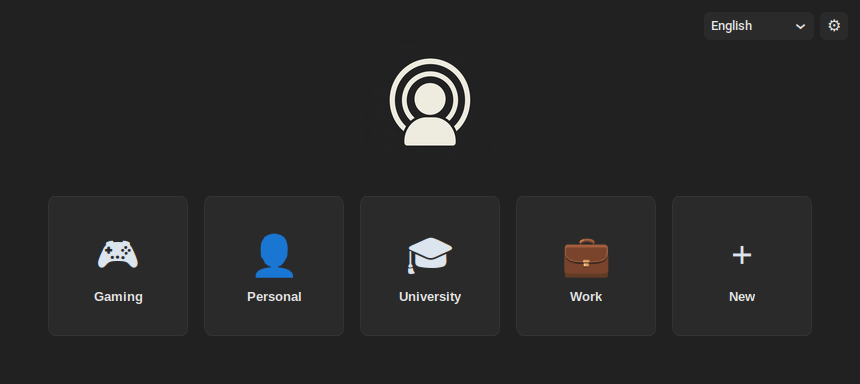
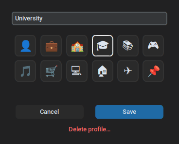
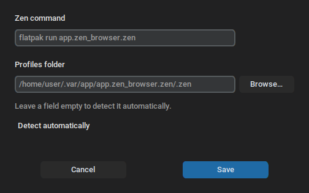

# zen-profile-selector

A small, fast profile picker for [Zen Browser](https://zen-browser.app) on Linux.

Click a profile and Zen opens with it. Create, rename, re-icon and delete profiles without ever opening Zen's `about:profiles` page.

> **Unofficial project.** Not affiliated with, endorsed by or supported by the Zen Browser team.



## Features

- **Profile grid**: one card per Zen profile, each with its own emoji icon. Up to five cards share a row, then the grid switches to rows of three. The window sizes itself to its content and opens centered on your primary monitor.
- **Create profiles**: the "＋ New" card asks for a name and an icon, then creates the profile through Zen itself (`--CreateProfile`), even while Zen is running.
- **Edit profiles**: hover a card and click ✎ to rename it or change its icon. Renaming only changes the displayed name; the profile folder, with your bookmarks, passwords and history, is not touched.
- **Safe deletion**: you must type the profile name to confirm. Profiles that are open in Zen cannot be deleted, the last profile cannot be deleted, and the profile folder goes to your **Trash**, so it can be restored. A backup of `profiles.ini` is written before every change.
- **Works with any Zen install**: detects the Flatpak (`app.zen_browser.zen`) and native installs (`zen` / `zen-browser` on your `PATH`) automatically. If detection fails, set the Zen command and profiles folder by hand in **Settings** (⚙, top right).
- **English and Italian**: pick the language from the menu next to ⚙. The choice is remembered.

| Edit a profile | Settings |
|---|---|
|  |  |

## Requirements

- Linux with X11 or XWayland
- Python 3.9 or newer, with Tk (`sudo apt install python3-tk` on Debian, Ubuntu and Mint)
- [pipx](https://pipx.pypa.io)
- Zen Browser
- Optional: `gio` (to move deleted profiles to the Trash) and `xrandr` (to center the window on the primary monitor). Both ship with most desktops.

## Install

```bash
pipx install git+https://github.com/FedericoGrim/zen-profile-selector
```

Add it to your applications menu:

```bash
zen-profile-selector --install-desktop
```

Remove it from the menu with `--uninstall-desktop`, and uninstall it with `pipx uninstall zen-profile-selector`.

## Configuration

Everything is stored in `~/.config/zen-profile-selector/` (or `$XDG_CONFIG_HOME/zen-profile-selector/`):

| File | Contents |
|------|----------|
| `config.json` | Language, and the Zen command and profiles folder if you set them by hand |
| `profile_icons.json` | The icon of each profile, by name |

Leave the Zen command and profiles folder empty to let the selector detect them.

## How it works

The selector reads Zen's `profiles.ini` from the detected profiles folder:

- Flatpak: `~/.var/app/app.zen_browser.zen/.zen`
- Native: `~/.zen`

Creating a profile is delegated to Zen (`--CreateProfile`). Renaming and deleting edit `profiles.ini` directly, because Zen has no command for them; the previous version is kept as `profiles.ini.selector-bak`. In that case the selector keeps the `[ProfileN]` sections numbered without gaps (Zen stops reading at the first gap), and moves the default profile to another one if needed.

## Limitations

- Linux only. Windows and macOS are not supported.
- On native Wayland, Tk cannot choose where the window opens, so centering depends on your window manager.
- Zen's newer experimental profile system ("Profile Groups") is not supported. Zen currently keeps it disabled.

## Contributing

Contributions are welcome: bug reports, translations, packaging and code. Start with [CONTRIBUTING.md](CONTRIBUTING.md), browse the [roadmap](https://github.com/FedericoGrim/zen-profile-selector/labels/roadmap) and the [`good first issue`](https://github.com/FedericoGrim/zen-profile-selector/labels/good%20first%20issue) label, and ask anything in [Discussions](https://github.com/FedericoGrim/zen-profile-selector/discussions).

Please follow the [Code of Conduct](CODE_OF_CONDUCT.md) and report security problems privately as described in [SECURITY.md](SECURITY.md). Design decisions are recorded in [docs/decisions.md](docs/decisions.md).

## Author

Made by Federico Grimaldi — federico.grimaldi2006@gmail.com

## License

[GNU General Public License v3.0 or later](LICENSE).
